# School Management Workflow & Panel Pipeline Blueprint

**Purpose:** A detailed, implementation-oriented specification of how a school-management system can organize its panels, roles, records, approvals, reports, notifications, and cross-product workflows using the publicly documented capabilities of the Zoho education ecosystem as a reference.

**Prepared:** 26 October 2026  
**Status:** Research-backed blueprint; not a verified configuration export from a live Zoho tenant.  
**Primary starting point:** Zoho Creator's School Management application.  
**Related products considered:** Zoho CRM, Zoho Connect, Zoho Learn, Zoho Classes, Zoho Projects, Zoho WorkDrive, Zoho Tables, Zoho Assist, and Zoho Survey.

> **Important accuracy note:** This document does not claim to reproduce hidden source code or a private Zoho tenant. Official pages document product capabilities, while the exact roles, buttons, field permissions, approval routes, and integrations depend on an application's configuration, edition, and deployment. Anything labelled **Recommended design** or **Inferred** is an implementation blueprint, not a claim that it is enabled by default in Zoho.

---

## 1. How to read this document

Each important statement uses one of these labels:

- **[CONFIRMED]** — directly supported by a cited official Zoho product/help page.
- **[RECOMMENDED DESIGN]** — a proposed rule or component for a well-controlled school-management implementation.
- **[INFERRED]** — a reasonable conclusion about how a school workflow could be assembled; it must be tested in the actual tenant.
- **[UNKNOWN / VERIFY]** — cannot be confirmed from the public product pages alone.

The word *panel* means a role-focused application interface. A panel may share underlying modules with other panels, but the current user sees only the permitted navigation, data, and actions.

### Main principle

**A hidden button is not security.** The backend/API must enforce every role and record-scope rule even when a user directly calls an endpoint or changes a URL/record ID.

---

## 2. Product map and system boundaries

### 2.1 Recommended responsibility by product

| Product | Intended responsibility in this blueprint | Roles likely to use it | Evidence boundary |
|---|---|---|---|
| **Zoho Creator** | Core school records, configurable forms, reports, dashboards, school workflows, student/teacher/parent-facing portals | Admin, Principal, Teachers, Students, Parents | **[CONFIRMED]** Creator's public school app describes assignment collection, attendance, exams/grading, lesson notes/notices, student portal, and parent access to a child's performance/attendance. [Source](https://www.zoho.com/creator/apps/school-management-system-software.html) |
| **Zoho CRM** | Admissions inquiries, prospective-student pipeline, follow-up and student lifecycle tracking | Admin, Principal/admissions staff, applicant/parent portal where configured | **[CONFIRMED]** Education CRM page describes education lifecycle needs. Actual field/module mapping must be inspected. [Source](https://www.zoho.com/crm/verticals/education/) |
| **Zoho Connect** | Campus announcements, circulars, department/community groups, events, discussions, requests and feedback | Admin, Principal, Teachers, invited students/parents where permitted | **[CONFIRMED]** Education page lists Company Wall, scheduled posts, mandatory reads, groups/channels, forms/workflows, polls/surveys and events. [Source](https://www.zoho.com/connect/education.html) |
| **Zoho Learn** | Learning hub, lesson/course content, quizzes, assignments, grading/feedback, learner progress | Course authors/admins and learners | **[CONFIRMED]** Learn documents rich lessons, assessments, drip schedules, discussions, reporting and certificates. [Source](https://www.zoho.com/learn/online-lms-software.html) |
| **Zoho Classes** | Separate education/LMS offering for class/course activity, schedules and academic work | Educators and learners; exact school-level roles require verification | **[CONFIRMED]** Classes is presented as a distinct product from Learn. Do not assume it is an old name for Learn. [Source](https://www.zoho.com/classes/) |
| **Zoho Projects** | Academic/administrative projects, task plans, milestones, workload, time tracking, custom reports/dashboards | Admin, Principal, staff project members | **[CONFIRMED]** Education page describes tasks, calendars, forums, timesheets, workload reports, custom modules and dashboards. [Source](https://www.zoho.com/projects/education-project-management.html) |
| **Zoho WorkDrive** | Controlled document storage and collaboration by department, class or project | Admin, Principal, Teachers; student/parent access only when deliberately shared | **[CONFIRMED]** Team Folder roles include Admin, Organizer, Editor, Commenter and Viewer, with scope specific to each folder. [Source](https://help.zoho.com/portal/en/kb/workdrive/team-folder-basics/articles/team-folder-roles-and-permissions) |
| **Zoho Tables** | Structured trackers, lightweight workflow tables, project/request lists | Authorized admins/staff/collaborators | **[CONFIRMED]** Tables uses portal → workspace → base organization and portal/workspace/base access. [Source](https://help.zoho.com/portal/en/kb/tables/portal/articles/what-is-a-portal) |
| **Zoho Assist** | Remote support for school IT and authorized devices | IT support roles, not automatically school principals/teachers | **[CONFIRMED]** Assist has Super Admin, Admin and Technician role capabilities. [Source](https://www.zoho.com/assist/help/organization/manage-technicians.html) |
| **Zoho Survey** | Parent/student/teacher feedback, forms, survey analysis and reports | Survey makers, department admins, report viewers and respondents | **[CONFIRMED]** Survey documents Department Admin, User, Contractor and Report Viewer role models. [Source](https://help.zoho.com/portal/en/kb/survey/setup/set-up-department/roles-and-permissions/articles/roles-and-permissions) |

### 2.2 Logical architecture (proposed, not a default Zoho integration)

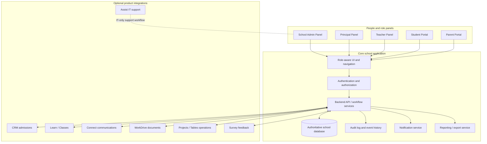

**Recommended design:** maintain a clear system of record for each entity, use stable IDs across integrations, and log every important sync and permission-sensitive change. Do not assume a record created in one Zoho product automatically appears in another product without a configured connection.

### 2.3 Integration contract for each product handoff

Every integration should document:

1. **Trigger:** what event starts the sync (e.g., application accepted, class assigned, result published).
2. **Source of truth:** which product/system owns the authoritative value.
3. **Mapping:** source field → destination field, including data type and required/optional status.
4. **Identity matching:** stable record ID, not name-only matching.
5. **Authorization:** which service/account can read/write which resource.
6. **Idempotency:** replaying the same event must not create duplicate students/payments/assignments.
7. **Failure handling:** retries, dead-letter/error queue, admin-visible error, safe reprocessing.
8. **Audit trail:** event ID, source ID, target ID, timestamps, status and sanitized error.
9. **Privacy:** do not send sensitive student fields to a product that does not need them.
10. **Verification:** test the full source → destination → user-interface journey using test records.

---

## 3. Roles, identity and permission architecture

### 3.1 Separate identity, job role, product role and record scope

A robust implementation must distinguish these concepts:

- **Identity/account:** login identity, email/username, authentication state, MFA/session rules if supported.
- **School role:** School Admin, Principal, Teacher, Student, Parent.
- **Product-native role:** Zoho Creator Admin, CRM Administrator, WorkDrive Editor, etc. These are not interchangeable with school roles.
- **Permission set:** allowed modules, pages, fields and actions.
- **Record scope:** which school, campus, academic year, class, student, child or assigned item the user may access.
- **Workflow authority:** who may approve, publish, reopen, reverse or archive a record.
- **Export authority:** whether the person may download or share data.

**[CONFIRMED]** Creator separates permissions, roles/role hierarchy and data-sharing rules. Its permission system controls actions and field permissions; hierarchy affects visibility of users' records; sharing rules extend record access. [Creator permission reference](https://help.zoho.com/portal/en/kb/creator/developer-guide/application-settings/manage-and-configure-user-permissions/articles/understand-permissions)

**[CONFIRMED]** CRM differentiates roles (data visibility/hierarchy) from profiles (feature/module access and actions). [CRM Admin Quick Start](https://help.zoho.com/portal/en/kb/crm/getting-started/articles/admin-quick-start)

**Implementation rule:** never map `School Admin = product Super Admin` by default. Assign only the privileges the job requires.

### 3.2 Recommended authorization decision order

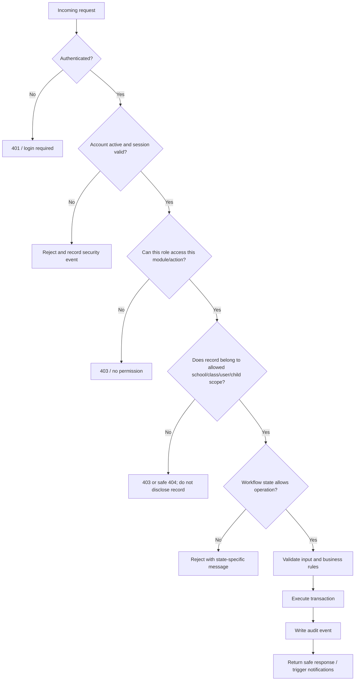

### 3.3 Default-deny rules recommended for every role

- A user receives no access to a module until it is explicitly granted.
- A user receives no access to another tenant/school's data unless specifically authorized.
- A Student can view only their own data, except explicitly shared class/learning content.
- A Parent can view only data tied to the verified guardian-child relationship.
- Teachers can see records for classes/subjects assigned to them, not all records merely because they are teachers.
- Principal visibility across the school is a deliberate policy decision and must not automatically grant financial/system configuration powers.
- Admin configuration rights do not automatically imply authority to change grades, erase fee history or approve their own exceptions.
- Export, bulk download and public sharing are separate privileges from viewing.
- Record ownership or hierarchy must not silently replace explicit school/class/child scope checks.
- Sensitive fields (contact details, medical needs, financial data, identity documents) need field-level restrictions.

### 3.4 Example permission matrix for a custom school app

This table is a **recommended initial policy**, not a verified default Zoho permission matrix. CRUD refers to create/read/update/delete. “Approve” means an explicit workflow decision.

| Module/action | School Admin | Principal | Teacher | Student | Parent |
|---|---|---|---|---|---|
| School configuration / academic year | Configure, CRUD | Read; request change | Read permitted calendar | Read published calendar | Read published calendar |
| User accounts and role assignments | Manage non-owner school roles | Read school user roster; request access | Read own profile; limited profile edit | Read own profile; limited profile edit | Read own profile/contact and linked-child relationship where permitted |
| Student master profile | CRUD within approved policy; sensitive actions audited | Read school-wide; edit only approved academic fields | Read assigned students; request corrections | Read own profile; request correction | Read linked child; submit correction request |
| Teacher/staff records | CRUD | Read staff/assignment data; approved edits | Read own profile and teaching assignments | No staff-directory private fields | No private staff records |
| Class/section/subject setup | Configure/CRUD | Review/approve academic setup if configured | Read assigned classes; no global setup | Read own classes/subjects | Read linked child's classes/subjects |
| Teacher assignment | Manage proposals/assignments | Approve or oversee, if configured | Read own assignment; flag conflict | Read teacher/course info where published | Read linked child's teacher/class info where published |
| Timetable | Configure; publish subject to policy | Approve/publish if configured | View assigned; propose correction | View own timetable | View linked child's published timetable |
| Attendance | Oversight and controlled corrections | Review exceptions; approve corrections if configured | Create/update for assigned classes during allowed window | View own attendance | View linked child's attendance |
| Assignment / lesson content | Operational oversight | Read school-wide summaries | Create/edit own assignments and materials | Submit work; view own feedback | View only permitted child progress, if enabled |
| Marks / grades | No unrestricted changes; controlled correction only | Review/approve exceptions if configured | Enter/edit grades for assigned classes before lock | View own published results | View linked child's published results |
| Report-card publication | Configure process; cannot bypass audit | Approve/publish where designated | Prepare results | View own published card | View linked child's published card |
| Fees / payments | Administer only if assigned finance authority | Read summary; approve exceptional transactions only if designated | No payment mutation by default | View own amount/status if enabled | View linked child's amount/receipt/status |
| Notices / announcements | Create, schedule and manage | Create/approve school-wide announcements | Create for assigned classes/subjects if permitted | Read relevant notices | Read parent-targeted notices |
| Leave requests | View/administer according to policy | Approve staff/student exceptions as defined | Approve student requests only if policy says so | Create own request; view status | Create/track linked child's request where enabled |
| Reports / exports | Explicitly permitted reports | Explicit leadership reports | Assigned classes only | Own reports only | Linked-child reports only |
| Audit logs | Authorized administrative/security access | Read relevant academic workflow history if allowed | Own actions / assigned workflow history as policy allows | No general audit logs | No general audit logs |
| Product integrations / API secrets | Designated technical admin only; secrets separated from school operations | No default access | No access | No access | No access |
| Hard delete / purge | Restricted break-glass function only | No default access | No access | No access | No access |

**Note:** “School Admin” in this product blueprint should not automatically be given the same all-record access as Creator's built-in Admin unless that is the documented and intended security role. Creator documentation states its app Admins have all data access and cannot be assigned ordinary permission sets. This is one reason to separate application ownership/configuration from day-to-day School Admin workflows. [Creator permissions](https://help.zoho.com/portal/en/kb/creator/developer-guide/application-settings/manage-and-configure-user-permissions/articles/understand-permissions)

---

## 4. Shared application shell and navigation

The five panels should share a predictable UI shell but produce different navigation and data based on role and scope.

### 4.1 Global shell components

| Component | Small/minute behavior | Permission / data rule |
|---|---|---|
| School logo/name | Shows tenant/school identity; optionally campus name | Derived from authenticated tenant; users cannot switch tenant by editing a client-side value |
| Campus/academic-year selector | Shows only campuses/years user is allowed to access | Server validates selected campus and year on every request |
| Global search | Searches only enabled record types within current user's access scope | Results must be permission-filtered server-side; no leakage through counts or autocomplete |
| Notification bell | Unread count; opens notice, task, attendance or approval items | User sees only notifications assigned to them or their role/scope |
| Tasks/approvals shortcut | Lists pending work that current role can act on | Backend checks eligibility again on submission; stale tasks cannot grant rights |
| User menu | Profile, security/session details, help, logout | No sensitive account secrets displayed; logout revokes/invalidates the session according to auth design |
| Breadcrumbs | Shows route hierarchy and active record context | Do not expose private names in breadcrumbs the user is not authorized to read |
| Help / support | Opens help docs or support form | Support messages must not include passwords, tokens or unrestricted student data |
| Loading state | Prevents duplicate actions while request is pending | Button disable is UX only; backend still handles idempotency |
| Empty state | Explains there are currently no records and provides permitted next action | Never insert fake rows to make a dashboard appear populated |
| Error state | Shows safe message and correlation/reference ID where available | Never show stack trace, secret, SQL text or internal server configuration |
| Audit/last-updated indicator | Shows relevant update timestamp and actor when policy permits | Do not reveal the identity of a restricted staff member if hidden by policy |

### 4.2 Navigation behavior

- Build menus from the server-authorized feature list or a trusted authorization model; never rely solely on front-end role-name checks.
- Deep links must re-check authorization on the API.
- When access is revoked, the next request should fail safely and stale client caches should be cleared/refetched.
- If a route is not permitted, show a safe access-denied page; do not silently render another role's dashboard.
- Changing the role label in local storage, URL or browser state must never change authorization.

---

## 5. School Admin panel — detailed component specification

### 5.1 Responsibility boundary

The School Admin manages school setup and routine operations within delegated permissions. A separate technical/system owner may control security settings, integrations, tenant-level configuration and secret management. This avoids giving every operational admin unrestricted application-owner powers.

### 5.2 Main navigation

1. Overview / dashboard
2. Students
3. Parents / guardians
4. Teachers and staff
5. Academic setup
6. Classes and sections
7. Subjects and teaching assignments
8. Timetable / calendar
9. Attendance oversight
10. Examinations and results setup
11. Fees / finance (only if implemented and explicitly assigned)
12. Notices and communication
13. Leave / requests
14. Reports and exports
15. Documents
16. User access and role assignments (if delegated)
17. Integrations / sync health (technical admins only)
18. Audit and configuration (restricted)

### 5.3 Admin dashboard widgets

| Widget | Data source | Actions | Important rules |
|---|---|---|---|
| Total students | Active enrollment records for selected academic year | Open filtered student roster | Include a documented inclusion rule for active/withdrawn/graduated records |
| Staff count | Staff records filtered by status | Open staff roster | Do not count archived users as active staff |
| Class/section coverage | Class and enrollment tables | Open unassigned/over-capacity classes | Use current academic year and campus filter |
| Attendance snapshot | Attendance sessions/entries for chosen date | Open absence and missing-attendance list | Missing attendance is not the same as 0% attendance; distinguish “not submitted” from absent students |
| Pending approvals | Approval queue filtered to permitted actions | Open approval detail | Admin should see only approval types they are permitted to decide |
| Enrollment pipeline | CRM/application statuses or synchronized enrollment records | Open admissions/enrollment funnel | Clearly label CRM data versus Creator student master; show sync failures |
| Unassigned students | Active enrollment rows lacking valid class/section | Open assignment wizard | Prevent class assignment to inactive academic year/section |
| Data-quality alerts | Duplicate IDs, missing guardians, missing class assignments, invalid references | Open remediation list | Do not silently merge or delete records automatically |
| Integration health | Sync events, failures and last successful sync | Retry/review error, if authorized | Never show API secret values; retry must be idempotent |
| Recent activity | Audited changes relevant to this admin | Open record/audit entry | Respect access controls for field values and student identity |

### 5.4 Student management panel: minute operation sequence

**Student list**

- Columns: student ID, name, class/section, academic year, enrollment status, guardian-link status, record updated date.
- Filters: campus, academic year, class, section, status, missing guardian, missing required fields.
- Search: student ID and approved identifying fields; do not return hidden sensitive fields in autocomplete.
- Row actions: open, edit permitted details, view enrollment history, assign class, link guardian, archive/withdraw per policy.
- Bulk actions: only explicitly authorized and logged; show a preview/count before applying.
- Delete: prefer archive/withdraw for academic records. Hard deletion is a restricted break-glass action only after dependency and retention checks.

**Create student form**

1. Validate required fields in the browser for usability.
2. Submit to backend; backend validates all fields again.
3. Check unique student ID and any configured uniqueness rules.
4. Validate academic year, campus, class/section references.
5. Validate guardian relationship and permissions.
6. Save master record and linked records inside a database transaction where appropriate.
7. Write audit event and record creator.
8. Trigger user/guardian provisioning only if configured; avoid making duplicate accounts.
9. Display saved ID and next steps; refresh list from server.

**Edit student form**

- Show ordinary fields and sensitive fields separately according to permissions.
- Display field-level validation errors beside fields.
- Preserve change history for sensitive fields and academic identity changes.
- Use optimistic concurrency/version checks to avoid overwriting another user's edit.
- Prevent changing the ID of an existing student through an ordinary profile edit if IDs are immutable by policy.

### 5.5 Teacher/staff management

- List active/inactive status, department, subjects, assigned classes, and workload indicators.
- Create or invite a staff member; verify unique account/email; do not use a shared login.
- Assign teaching role and authorized classes/subjects separately from product-owner/admin rights.
- Assign class teacher or subject teacher with effective start/end dates.
- Check timetable conflicts before finalizing workload assignments.
- Removing a teacher from a class must not erase historic attendance, grades or old timetable records.
- Deactivating a staff login should revoke future access while preserving attributable historical records.

### 5.6 Academic setup

Maintain:

- School/campus and academic year
- Term/semester
- Class and section
- Subject/catalog
- Teacher-subject-class assignment
- Grading scheme and assessment types
- Timetable templates and published timetable revisions
- Attendance policies and allowed correction window
- Leave/request types and approvers
- Notice categories and target audiences

For every setup form, specify the effective date, academic year, campus scope, editor and approval state. Do not allow a class or subject to be removed while active enrollments depend on it without a controlled migration/archive workflow.

### 5.7 Admin approval queue

Each item should display:

- Request ID and type
- Initiator and submission time
- Student/class/period context, limited to authorized fields
- Previous value and proposed value for corrections
- Reason/attachment
- Current state and next approver
- Approve / reject / request changes actions, only if permitted
- Mandatory reason for rejection or high-impact override
- Audit history and timestamp after decision

Never show the Approve button as the only enforcement. The backend must verify role, scope, current state, and separation-of-duties rules at submission time.

---

## 6. Principal panel — detailed component specification

### 6.1 Responsibility boundary

The Principal's panel is for academic and institutional oversight. It should have broad visibility into the school's permitted academic metrics but should not automatically be a super-admin console. Any principal-level override must be an explicit capability with logging and, for high-impact actions, a reason and possibly a second approver.

### 6.2 Main navigation

1. Principal overview
2. Enrollment and student census
3. Attendance and exceptions
4. Class/teacher allocations
5. Timetable review
6. Academic progress
7. Assessment/exam results review
8. Report-card publication queue
9. Staff workload and availability
10. Requests and approvals
11. Parent/student communication oversight
12. Reports and exports
13. Audit trail for academic decisions, if permitted

### 6.3 Dashboard components

| Widget | What it shows | Typical interaction | Control boundary |
|---|---|---|---|
| Enrollment summary | Counts by grade/section/status | Drill into permitted student list | Read visibility can be whole-school; record edits are separately restricted |
| Attendance risk list | Persistent absences, missing attendance submissions, threshold exceptions | Open case; assign follow-up or request correction | Does not let principal silently rewrite attendance; correction workflow required |
| Academic performance trend | Grade/subject/term aggregates | Drill into class/subject report | Show aggregate by default; individual student drill-down only for authorized academic need |
| Exam/result status | Marks pending, missing assessments, outlier/invalid values | Open review queue | No automatic publication of incomplete results |
| Timetable conflict summary | Double-booked rooms/teachers or missing coverage, if checks exist | Request rework or approve schedule | Do not claim conflicts are detected unless rules/data support it |
| Teacher workload | Assigned classes, planned periods, pending grading | Open teacher workload view | Staff-sensitive notes should not be exposed by a summary tile |
| Parent communication status | Notices sent/read/acknowledged where supported | Open follow-up list | “Delivered”, “opened” and “acknowledged” are distinct states |
| Approval queue | Requests awaiting principal decision | Review, approve, reject or request changes | Backend validates approver eligibility and current request status |
| Risk/exception summary | Unresolved academic or operational issues | Assign owner and due date | Explain the rules that flag a record; do not label a student without evidence |

### 6.4 Principal review process for final grades

1. Teacher submits grades for the assigned class/subject.
2. System validates score ranges, required assessments and missing values.
3. Grade set moves from `DRAFT` to `SUBMITTED`.
4. Principal/examination approver sees a read-only review snapshot and validation warnings.
5. Approver may `APPROVE`, `REJECT` with reason or `RETURN_FOR_CORRECTION`.
6. Approved grade set becomes `PUBLISHED` only after the publication action.
7. Student/parent portals show the published version only.
8. A post-publication correction creates a new audited correction/version; do not silently overwrite the historical result.

**[RECOMMENDED DESIGN]** A Principal may approve exceptions and publish results, but should not edit raw teacher marks without a controlled correction record. This preserves accountability.

### 6.5 What the Principal should not automatically control

- Global credentials, integration secrets or subscription billing.
- All product-level admin settings.
- Another school's records in a multi-school deployment.
- Financial refunds/fee adjustments unless formally assigned.
- Unlogged changes to attendance, marks or report cards.
- Permanent deletion of a student and dependent records.

---

## 7. Teacher panel — detailed component specification

### 7.1 Main navigation

1. My teaching dashboard
2. My classes and sections
3. My timetable
4. Attendance
5. Assignments and homework
6. Assessments / exams
7. Marks and grading
8. Lesson materials
9. Student progress (assigned students only)
10. Parent communication (approved channels only)
11. Notices
12. Leave/availability/request submission
13. My reports
14. Profile and support

### 7.2 Teacher dashboard widgets

| Widget | Data / interaction | Minute behavior and restrictions |
|---|---|---|
| Today's timetable | Published timetable slots | Sort by time; open class only if teacher is assigned; show room/online link if present |
| Attendance pending | Assigned class sessions not submitted for the day | Open roster; distinguish `NOT_STARTED`, `IN_PROGRESS`, `SUBMITTED`, `LOCKED` |
| Missing submissions | Assignments with no submission/late status | Filter by class, assignment and deadline; do not reveal other class records |
| Grading queue | Submissions and assessments awaiting grading | Open rubric/score entry; autosave draft where supported; submit when complete |
| Upcoming exams | Assessments assigned to teacher | Shows date, class, subject, preparation state and permitted actions |
| Class alerts | Attendance/academic exceptions for assigned class | Shows rule and evidence; avoids unsupported diagnosis or stigmatizing labels |
| Announcements | Relevant school/class notices | Read/acknowledge; post only if role has publishing permission |
| Parent messages/requests | Messages routed to this teacher | Open child's permitted profile context; escalate sensitive requests rather than disclosing unrelated records |

### 7.3 Attendance recording: detailed UI behavior

**Roster columns:** student ID/name, attendance status, optional approved reason, note/action indicator. Do not expose unrelated personal or financial data on the roster.

**Statuses:** recommend `PRESENT`, `ABSENT`, `LATE`, `EXCUSED` and `NOT_MARKED`, with `NOT_MARKED` kept distinct from absent. Additional states must match school policy.

**Workflow:**

1. Teacher opens an assigned class and a valid date/session.
2. Server verifies assignment, class, date and attendance window.
3. Roster is loaded from active enrollment records for that date.
4. Teacher marks each student; bulk mark-present is an optional convenience, not a default stored assumption.
5. Validate every student belongs to the chosen class/session.
6. Save as draft or submit, according to policy.
7. On submit, store actor/time and set status; duplicate submissions should be idempotent or require an explicit revision.
8. Trigger parent absence notification only if the student/guardian mapping and contact/notification settings are valid.
9. After lock, any correction enters a correction workflow with old value, new value, reason, requester, approver and time.

**Failure cases:** no assigned class, wrong academic day, inactive student, duplicate attendance session, missing guardian contact, API timeout, late correction after lock. Each needs a visible safe response; the system must not silently fall back to fake attendance data.

### 7.4 Assignment lifecycle

- **Create:** title, subject/class, instructions, attachment/resource, due date/time zone, max score/rubric, permitted submission types, late policy.
- **Validate:** teacher is assigned to class/subject; due date is valid; attachments pass file checks.
- **Publish:** creates visible assignment for enrolled students and records publish time.
- **Student submission:** binds to student + assignment; stores submission version, file/reference, submitted timestamp, late flag and receipt ID.
- **Resubmission:** allowed only if policy/status permits; preserve prior versions or a version history.
- **Grade:** teacher records score and feedback; backend validates score range and assigned teacher.
- **Return/publish feedback:** student sees their own result; parent visibility follows policy.
- **Reporting:** completion rate, missing, late, submitted, graded, returned counts from real records.
- **Archive:** preserve submitted work and grade history under retention rules.

### 7.5 Marks entry and grading

- Select assigned assessment/class before entering marks.
- Load the correct enrolled roster and assessment maximum score.
- Validate numeric/rubric values, missing status, exemptions and score boundaries.
- Save draft separately from submit/publish.
- Show incomplete marks and validation errors before submission.
- Preserve the mark author and timestamps.
- A submitted or published grade requires appropriate permissions to alter.
- If marks are corrected, capture previous score, new score, reason and approval if required.
- A student should not see draft or unpublished marks.
- Parent sees a child's result only once allowed by the publishing policy.

### 7.6 Teacher data boundaries

- CRUD only for assigned course/assessment/attendance workflows.
- Read student records necessary for assigned teaching duties.
- No unrestricted access to all guardian contact details, medical information or finances.
- No user role management or API secret access.
- No hard delete of historical grades, attendance, submissions or student master records.
- No unlogged override of the Principal-approved/published state.

---

## 8. Student portal — detailed component specification

### 8.1 Main navigation

1. Student home
2. My profile
3. My timetable
4. My attendance
5. My subjects/classes
6. Assignments
7. Submissions and receipts
8. Quizzes/exams
9. Grades and report cards (published only)
10. Lesson materials / courses
11. Notices and events
12. Leave/request form (if supported)
13. Feedback/teacher evaluations (if enabled)
14. My documents
15. Notifications
16. Help/support

### 8.2 Student dashboard components

| Widget | What student sees | Action and security rule |
|---|---|---|
| Today's timetable | Only their published schedule | Open class/subject details; no timetable edit |
| Attendance summary | Own attendance totals/trend | Drill into own history only; explanations/appeals go through request flow |
| Due soon | Assignments that belong to enrolled courses/classes | Open assignment and submit before deadline or see late status |
| Submission status | Own work: draft/submitted/late/graded/returned | Download own receipt/feedback; do not inspect classmates' work |
| Upcoming assessments | Published assessments for enrolled classes | Read details and permitted instructions; no answer keys before release |
| Learning progress | Own course completion and assessments, if integrated | Progress calculated from actual events; no fabricated completion values |
| Published results | Own published scores/report card | Unpublished/draft results are not visible |
| School notices/events | Messages targeted to the student or class | Read/acknowledge; cannot edit official notices |
| Request status | Own leave/correction/support requests | View status/history; no alteration of approver decisions |
| Profile/document area | Approved personal data and own accessible documents | Sensitive changes are submitted for review, not silently self-approved |

### 8.3 Submission pipeline

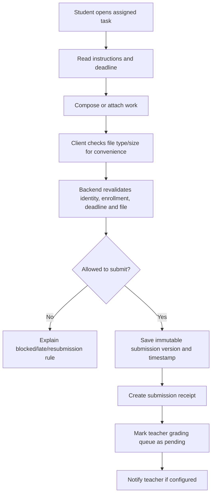

The receipt should identify the assignment, submission time, version and status. File upload controls must validate extension, size, content and storage permissions on the server; a front-end extension check is not sufficient.

### 8.4 Student privacy and constraints

- Do not allow editing a published grade or attendance record.
- A correction request creates a request/ticket; it does not mutate the official value.
- Do not expose classmate profiles, submissions, individual grades or parent contact details.
- Students can view only records tied to their authenticated student ID and current permitted enrollment history.
- Class-level materials may be shared with the class; student-specific feedback/results must remain individual.
- Logout/session expiration must block cached protected pages from fetching new data; do not rely only on hiding content.

---

## 9. Parent portal — detailed component specification

### 9.1 Identity-to-child relationship

A parent login is not enough to infer which students the parent may access. Use an explicit, verified guardian/student relationship table. One parent may have several linked children; one child may have more than one authorized guardian under school policy.

**Recommended relationship fields:** `guardian_id`, `student_id`, relationship type, verification status, contact/notification preferences, access start/end, who verified the link, verification timestamp, and whether this guardian is authorized for specific disclosures. Do not permit a parent to self-link to an arbitrary student ID.

### 9.2 Main navigation

1. Parent home
2. Child switcher (only verified linked children)
3. Child profile summary
4. Attendance
5. Timetable and calendar
6. Assignments / academic progress
7. Published grades and report cards
8. Fees and receipts (only if finance functionality is implemented)
9. Notices, circulars and events
10. Leave/absence/correction requests
11. Messages/contact channel
12. Documents shared with this family
13. Survey/feedback
14. Notification preferences
15. Help/support

### 9.3 Parent dashboard components

| Widget | Content | Interaction / restrictions |
|---|---|---|
| Child selector | Verified linked children | Switching child updates every tile and API query; stale data from previous child must clear before render |
| Attendance overview | Child's attendance and recent absences | See own linked child only; submit a request/query rather than directly editing attendance |
| Upcoming timetable | Published classes/exams/events for selected child | No editing school timetable |
| Assignments/progress | Published student progress and due/missing work where allowed | Do not show internal teacher notes not intended for guardians |
| Report cards | Published results for selected child | Never expose another child's report by editing a URL/query parameter |
| Notices | Parent- or class-targeted announcements | Acknowledgement is recorded separately from delivery/read status where supported |
| Fees/receipts | Child-linked fee obligations/payments if integrated | Show verified transaction status only; do not mark a payment successful based on a browser return URL alone |
| Request form | Absence explanation, profile correction, leave/meeting request | Create a request record with status; approval depends on workflow, not parent role |
| Documents | Documents explicitly shared with guardian | Enforce signed/authorized download links and scope on every request |
| Communication preferences | Email/app alert preferences where supported | A preference may suppress optional alerts, not legally/operationally required notices if policy dictates otherwise |

### 9.4 Parent request workflow

1. Parent selects a verified linked child.
2. The request form records `guardian_id`, `student_id`, request category, message, attachments and submission time.
3. Backend checks that guardian-child link is current and permits this action.
4. Routing rule sends request to the responsible Teacher/Admin/Principal based on type.
5. Responsible user accepts, rejects or asks for more information.
6. If the request changes official data, update only through the authorized correction workflow.
7. Parent sees a safe status and decision message; internal notes remain private.
8. Every state transition is audited.

### 9.5 Parent role restrictions

- No access to siblings unless separately linked and authorized.
- No editing attendance, marks, report cards or payment reconciliation directly.
- No teacher/admin dashboard or private staff notes.
- No broad export of all students or parent contact information.
- No access to hidden assessments, unpublished grades or staff-only communications.
- Parent requests must never be treated as approved simply because they were submitted.

---

## 10. Core data model — record-by-record blueprint

The following is a proposed relational model, not a statement of Zoho's internal schema. Names can be adapted to the existing implementation.

| Entity | Important fields | Purpose / validation |
|---|---|---|
| `School` | `school_id`, name, status, timezone, policy settings | Tenant boundary; all school-owned records must resolve to this tenant |
| `Campus` | `campus_id`, `school_id`, name, status | Optional multi-campus separation |
| `AcademicYear` | `academic_year_id`, school, label, start/end date, status | Limits enrollment, timetable, attendance and report-period rules |
| `Term` | `term_id`, academic year, dates, status | Assessment/report periods |
| `UserAccount` | `user_id`, login, hashed credential reference, status, auth metadata | Identity only; don't put plain-text passwords here |
| `UserRoleAssignment` | user, school role, scope, effective dates, assigner | A user may have different allowed scopes; changes are audited |
| `Student` | student ID, profile fields, status, school | Student identity; avoid duplicating authoritative fields across modules |
| `Guardian` | guardian ID, contact and verification fields | Guardian identity; sensitive data has field-level restrictions |
| `GuardianStudent` | guardian ID, student ID, relationship, status, verified_by | Enforces parent-to-child scope; no arbitrary self-linking |
| `Staff` | staff ID, user ID, job role, status, department | Staff directory and employment status |
| `Class` | class ID, academic year, grade/level, campus, status | Academic cohort |
| `Section` | section ID, class ID, section name, capacity, status | Grouping of students |
| `Enrollment` | student, academic year, class/section, status, effective dates | Determines student's active academic scope |
| `Subject` | subject ID, code, name, grade/level, status | Subject catalog |
| `TeachingAssignment` | teacher, class/section, subject, date range, status | Authorizes teacher actions in that instructional scope |
| `TimetableSlot` | class/section, subject, teacher, room, start/end, recurrence, version/status | Published schedule; validate time/teacher/room conflicts if rules exist |
| `AttendanceSession` | class/section, date/period, status, submitted_by, submitted_at, lock_at | One attendance event for a class/date/period |
| `AttendanceEntry` | session, student, status, reason, edited_by, timestamps | Individual student attendance; unique session+student constraint |
| `AttendanceCorrection` | entry, old/new values, reason, requester, approver, status | Separate audit-friendly correction workflow |
| `Assignment` | course/class, teacher, title, instructions, due date, max score, status | Work assigned to an authorized class/course |
| `Submission` | assignment, student, version, file reference, submitted time, late flag, status | Unique submission/version; receipt and immutable history |
| `Assessment` | assessment ID, class/subject/term, maximum score, grading rules, status | Scheduled test/exam or formal assessment |
| `Mark` | assessment, student, score/grade, state, entered_by, published_at | Unique assessment+student; validate maximum and grade rules |
| `GradeCorrection` | mark, before/after, reason, approver, timestamps | Preserve final-result history |
| `ReportCard` | student, term, version, generated_at, state, published_by | Published report output linked to the underlying marks/version |
| `FeeSchedule` | academic year/grade, item, amount, due rules, status | Fee definition; only if finance module exists |
| `FeeObligation` | student, amount, due date, balance, state | Student-linked liability; do not infer payment status from client UI |
| `PaymentTransaction` | obligation, provider reference, amount, verified status, timestamps | Must be reconciled server-side against trusted provider event/API |
| `Receipt` | transaction, receipt number, issue time, status | Issued only after verified payment/reconciliation according to policy |
| `Notice` | category, message, creator, audience rule, schedule, publication state | Audience evaluated using server-authorized class/role scope |
| `NoticeDelivery` | notice, recipient, delivered/opened/acknowledged state, timestamps | Don't conflate sent, delivered, opened and acknowledged |
| `LeaveRequest` | requester, student/staff, dates, reason, state, approver | Request and decision tracked separately |
| `DocumentReference` | owner record, storage key, MIME type, size, classification, permissions | Store metadata/access policy; file content lives in authorized storage |
| `Notification` | recipient, category, reference ID, state, sent time | Never send private details to an unverified recipient |
| `IntegrationEvent` | source, event ID, target, status, attempt count, error code | Idempotent sync and diagnosable failure handling |
| `AuditEvent` | actor, action, record type/ID, before/after diff, reason, timestamp, correlation ID | Append-only audit; restrict audit-log visibility |
| `ApprovalRequest` | type, source record, requester, reviewer, state, due date, decision/reason | Workflow engine; reviewer eligibility checked at runtime |

### Entity relationships at a glance

```mermaid
erDiagram
    SCHOOL ||--o{ CAMPUS : contains
    SCHOOL ||--o{ ACADEMIC_YEAR : defines
    ACADEMIC_YEAR ||--o{ CLASS : organizes
    CLASS ||--o{ SECTION : contains
    STUDENT ||--o{ ENROLLMENT : has
    SECTION ||--o{ ENROLLMENT : enrolls
    GUARDIAN ||--o{ GUARDIAN_STUDENT : linked
    STUDENT ||--o{ GUARDIAN_STUDENT : linked
    TEACHER ||--o{ TEACHING_ASSIGNMENT : assigned
    SECTION ||--o{ TEACHING_ASSIGNMENT : receives
    SUBJECT ||--o{ TEACHING_ASSIGNMENT : covers
    SECTION ||--o{ ATTENDANCE_SESSION : schedules
    ATTENDANCE_SESSION ||--o{ ATTENDANCE_ENTRY : includes
    STUDENT ||--o{ ATTENDANCE_ENTRY : receives
    ASSIGNMENT ||--o{ SUBMISSION : receives
    STUDENT ||--o{ SUBMISSION : submits
    ASSESSMENT ||--o{ MARK : records
    STUDENT ||--o{ MARK : earns
    STUDENT ||--o{ REPORT_CARD : receives
```

---

## 11. Detailed workflows and state transitions

### 11.1 Admissions → enrollment

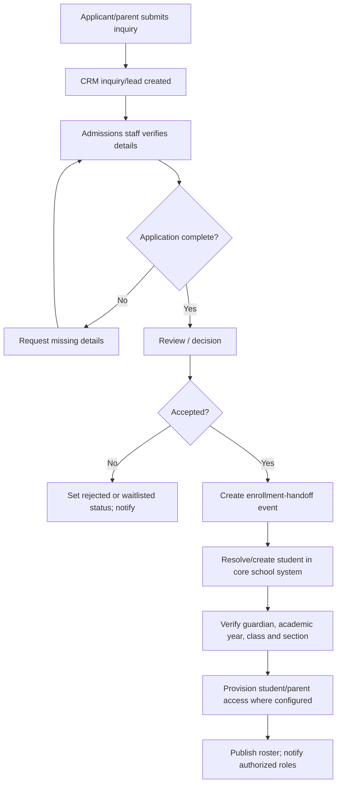

**Actors:** applicant/parent → admissions staff → designated approver → School Admin/academic team.  
**Records:** CRM inquiry/application, decision, core student record, enrollment, guardian linkage, provisioned account reference.  
**Reports:** inquiry funnel, applications by status, acceptance/enrollment count, incomplete application list.  
**Permissions:** admissions users manage the pipeline within CRM rights; only authorized users create/confirm official enrollment; parent only accesses verified linked child.  
**UNKNOWN:** exact conversion automation and whether CRM and Creator are linked in the user's deployment.

### 11.2 Class assignment / annual rollover

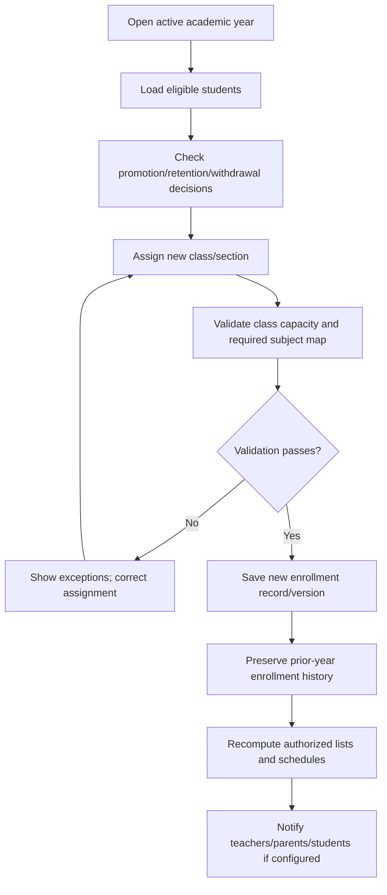

- Do not overwrite last year's enrollment in a way that destroys historical class scope.
- A student can have one active primary enrollment per academic year under the school's rule, but transfers may require effective-dated records.
- Reports should specify which academic year is selected.
- Teachers' scopes must update from teaching assignments; don't keep access to former classes indefinitely.

### 11.3 Timetable workflow

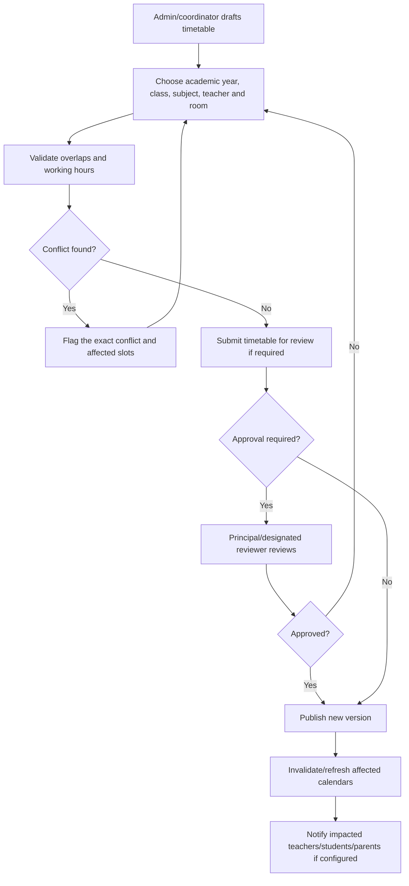

- The overlap checker must be a backend rule, not merely a calendar visual warning.
- Every published revision should record who published it and when.
- Replacing a timetable must not silently mutate historical attendance sessions.

### 11.4 Attendance workflow

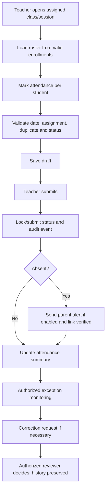

- Key status values: `NOT_STARTED`, `DRAFT`, `SUBMITTED`, `LOCKED`, `CORRECTION_PENDING`, `CORRECTED`.
- `ABSENT` is a student value; it must not be used to represent a session a teacher has not submitted.
- Parent alert delivery failure should create a visible retry/error record; it must not revert attendance.
- Corrections should record old/new value and reason; approval depends on policy.

### 11.5 Assignment → submission → grading

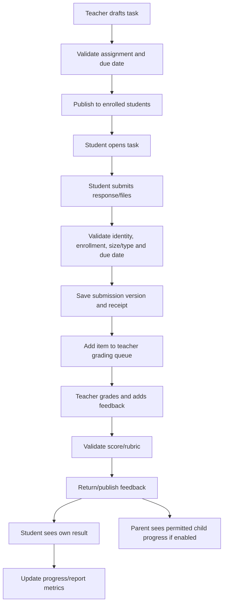

- An upload failing validation must not be recorded as submitted.
- A timeout must not create duplicate submissions on retry; use an idempotency token or a stable submission operation ID.
- Store submission receipt details and retain versions based on academic policy.
- Grade visibility is driven by publication state, not the mere presence of a score in the database.

### 11.6 Examination / report-card lifecycle

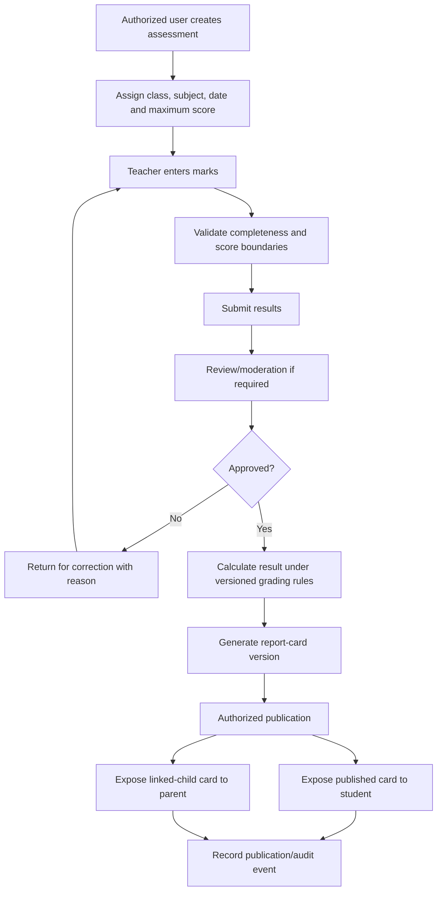

- Define how missing, exempted, absent and zero scores differ.
- Grade scale/rounding rules must be versioned and testable.
- Do not regenerate an already-published report using a changed grading scheme without marking a new version.
- A post-publication correction should create an auditable amendment.

### 11.7 Fees / payments — if fee management exists

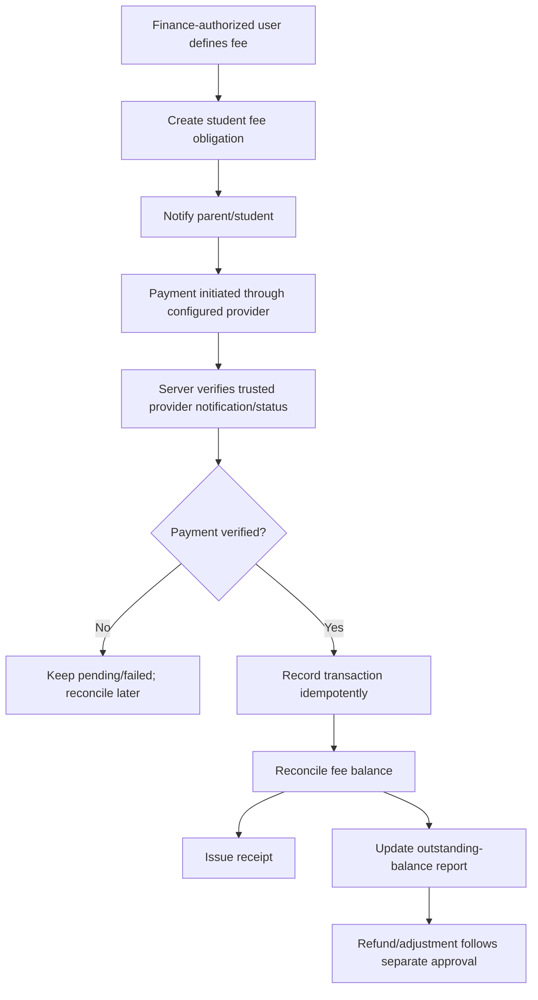

- Never mark a payment successful based only on a browser redirect, screenshot, or client-supplied status.
- Use the provider's verified server-to-server notification/API and reconcile amount, currency, merchant/order reference and transaction status.
- Use unique provider transaction IDs and idempotent callbacks.
- Refunds and manual adjustments should require a reason, actor, approver and audit event.
- The existence of a Zoho school app page does not by itself prove a native fees module or payment integration is present.

### 11.8 Notices / communications

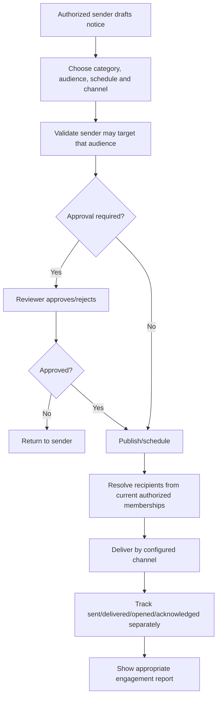

- Audience options may include whole school, campus, class/section, staff, parents of a class, or an individually selected allowed audience.
- Confirm recipient scope server-side at publication time.
- Do not send private student details in a broadcast to a whole class.
- A notice should show a clear audience and publication state before the sender confirms.

### 11.9 Leave and correction requests

1. Student/parent/teacher creates a request, selecting the affected person and date/type.
2. The server checks the actor-to-subject relationship and whether the request type is permitted.
3. The workflow assigns an approver based on school rules.
4. Approver sees only necessary details, previous decisions and supporting evidence.
5. Approver approves/rejects/returns for information with a reason.
6. If approved, the downstream record is updated only through the dedicated service and constraints.
7. Requester receives status notification.
8. Full state history is retained.

Never treat a submitted absence note as an approved leave decision or change attendance automatically unless the policy explicitly defines and tests that transition.

---

## 12. Panel control: how administrators manage pages, menus, forms, buttons and fields

### 12.1 Panel access is composed of layers

A user should see or execute an operation only if all relevant layers allow it:

1. **Application access:** can this account enter the school application?
2. **Role access:** is the feature available to this school role?
3. **Action permission:** may the role view/create/edit/delete/approve/export/configure?
4. **Record scope:** does this particular student/class/record belong to the allowed scope?
5. **Field scope:** can this role see or change this field?
6. **Workflow state:** is the record currently editable or awaiting someone else's approval?
7. **Policy constraints:** does the operation violate a time window, academic lock, payment state or separation-of-duties rule?

### 12.2 Admin configuration screen (recommended)

Provide a restricted `Access Control` console with:

- Role list and role description
- Page/module matrix
- Action matrix (view/create/edit/delete/approve/export/configure)
- Record-scope selector (school/campus/class/assigned students/own record/linked child)
- Field-level visibility/editability matrix
- Workflow action matrix (submit/approve/reject/publish/reopen/correct/archive)
- Export/share permissions
- Effective dates and status for assignments
- Preview-as-role function using a test identity, with clear non-production simulation rules
- Change summary and audit log
- Approval/review for high-risk permission changes

**Do not allow a role editor to grant itself elevated rights without an independent authorized approval**, where the threat model requires that separation.

### 12.3 Backend enforcement examples

**Example: teacher reads a student profile**

- Authenticate teacher.
- Load teaching assignments for the requested class/subject and time period.
- Verify the student is enrolled in that assigned class in the applicable academic year.
- Apply field permissions (e.g., don't include family finance/medical details unless truly needed).
- Return only allowed fields.
- Audit sensitive record access if policy requires it.

**Example: parent opens `/students/123/report-card`**

- Authenticate parent.
- Resolve parent user to verified guardian identity.
- Check active guardian-to-student link for student 123.
- Check card belongs to that student and its state is `PUBLISHED`.
- Return only permitted report fields and files.
- A mismatched link returns safe denial/not-found; don't reveal whether another child's record exists.

**Example: student submits marks update request**

- The student cannot `PATCH /marks/{id}` directly.
- They can create a correction/request ticket linked to their own mark.
- The request is routed to the authorized teacher/reviewer.
- Only an authorized decision updates the mark through a controlled service.

### 12.4 Permission change lifecycle

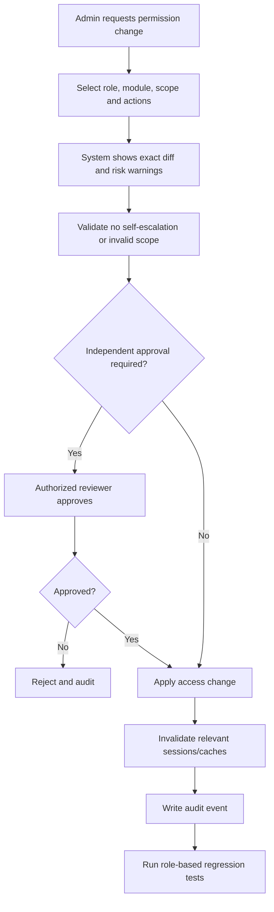

---

## 13. API and data pipeline — request to persisted result

Every interactive component should follow the same predictable lifecycle.

1. **User action:** click, submit, select, upload, approve or export.
2. **Client pre-validation:** required fields and helpful UX checks; not the security boundary.
3. **Authentication:** request carries valid session/cookie/token via the application's supported method.
4. **API authorization:** check role, action, record scope and field permissions on the server.
5. **Business validation:** relationship, status, date, uniqueness, capacity, score ranges and related invariants.
6. **Database transaction:** persist data atomically; reject inconsistent updates.
7. **Audit event:** capture who/what/when/reason and record IDs; exclude secrets.
8. **Event/outbox:** enqueue notifications and external integration after durable save, if that architecture is used.
9. **Integration worker:** idempotent call to CRM/Learn/Classes/Connect/WorkDrive or other configured service.
10. **Result handling:** store success/failure, retry where safe, and expose operator status.
11. **UI response:** show confirmed success only after the server reports success; otherwise show a clear error.
12. **Refresh:** reload the authoritative data or update cache from the returned server response.

### 13.1 Recommended API endpoints (illustrative)

These are example design names, not confirmed Zoho endpoints.

| Feature | Example endpoint | Access check |
|---|---|---|
| Current user and permissions | `GET /api/v1/me` | Valid session; response only includes current user's allowed context |
| Students | `GET /api/v1/students` | Admin list scope; Principal read scope; teacher assigned students; student self; parent linked children |
| Student profile | `GET /api/v1/students/{studentId}` | Same per-record and field scope as above |
| Create student | `POST /api/v1/students` | Authorized enrollment/admin role; validated school/class context |
| Update student | `PATCH /api/v1/students/{studentId}` | Field-level edit permission; audit sensitive edits |
| Guardian link | `POST /api/v1/students/{studentId}/guardians` | Authorized staff; verify identity/relationship; prevent arbitrary self-linking |
| Timetable | `GET /api/v1/timetable?academicYearId=...` | Student/self, linked parent, assigned teacher or authorized leadership |
| Attendance | `POST /api/v1/attendance-sessions/{id}/entries` | Assigned teacher or authorized operator; valid session and roster |
| Attendance correction | `POST /api/v1/attendance-entries/{id}/corrections` | Authorized requester; cannot bypass lock/approval rules |
| Assignment | `POST /api/v1/assignments` | Teacher assigned to class/subject |
| Submission | `POST /api/v1/assignments/{id}/submissions` | Authenticated enrolled student; deadline, size/type and idempotency rules |
| Marks | `POST /api/v1/assessments/{id}/marks` | Assigned teacher/editor; score validation and state check |
| Publish results | `POST /api/v1/assessments/{id}/publish` | Explicit publish permission; approver separation and complete marks check |
| Notices | `POST /api/v1/notices` | Publisher permitted for selected audience/category |
| Reports | `GET /api/v1/reports/{reportKey}` | Report permission plus underlying record scope; export permission separately checked |
| Approvals | `POST /api/v1/approvals/{requestId}/decision` | Eligible reviewer, valid state, reason where required; reject self-approval if policy requires |
| Integration status | `GET /api/v1/integrations/events` | Designated integration admin; redact credentials and personal data |

### 13.2 Error semantics

- `400` or `422`: validation failure with field-level safe messages.
- `401`: unauthenticated or expired session.
- `403`: authenticated but unauthorized; use a safe not-found strategy where revealing resource existence is sensitive.
- `404`: requested resource is not available within the user's safe context.
- `409`: duplicate or conflicting state (e.g., duplicate session, simultaneous edit, already-approved request).
- `413`: upload exceeds size limit.
- `429`: rate limit.
- `5xx`: server-side failure; log correlation ID and safe error details.

The exact status conventions may be adapted to the project's API style, but the security and user feedback semantics must remain consistent.

---

## 14. Reports catalog and access specification

| Report | Generator | Readers | Source data | Scope rule | Special risk |
|---|---|---|---|---|---|
| Student master roster | School Admin/authorized operator | Admin, Principal; teacher subset; student/parent self views | Student + enrollment | Role and record scope | Mass export exposes PII |
| Enrollment funnel | CRM admissions/report role | Admissions, designated leadership | CRM inquiry/application statuses | CRM role/profile/sharing | Duplicate lead-to-student conversion |
| Class list | Authorized admin/Principal/teacher | Assigned teacher, students/parents' relevant views | Class, section, enrollment | Academic year and assignment | Stale enrollments cause wrong roster |
| Attendance register | Teacher for assigned sessions; authorized report user | Principal/admin summaries; student/parent self views | Attendance session/entries | Class, date, child/self | Not-submitted vs absent confusion |
| Absence follow-up | Authorized admin/teacher | Staff responsible for the case; parent sees relevant response | Attendance + notification records | Relevant student/class only | Sensitive family/health reason exposure |
| Timetable | Admin/coordinator | Principal, assigned teachers, students, linked parents | Published timetable version | Class/teacher/student membership | Unpublished draft visible too early |
| Assignment completion | Teacher/course admin | Student self status; parent summary if enabled; Principal aggregates | Assignment/submission | Course/class/student scope | Classmates' grades leak through group reports |
| Grade/marks list | Teacher/exam admin | Principal review; student/parent published slice | Assessment/marks | Assigned class and publish status | Draft/final state mismatch |
| Report card | Authorized exam/report user | Student and linked guardian after publication | Marks + grading rules + report-card version | Student/guardian relationship | Incorrect recipient or outdated version |
| Teacher workload | Admin/Principal | Teacher self summary where enabled | Teaching assignment + timetable | Staff/leadership scope | Employment-sensitive information |
| Fee balance/collection | Finance-authorized user | Finance/leadership summary; parent linked fee view | Fee obligations/payments/reconciliation | Student/guardian/finance scope | Unverified payment or refund status |
| Notice delivery | Authorized publisher/admin | Publisher and permitted leadership | Notice/delivery event | Audience and role scope | Confusing sent/opened/acknowledged |
| Integration failure | Technical/integration admin | Designated support roles | Integration event log | System ops scope | Tokens/PII in logs |
| Audit changes | Security/admin role; limited review access | Authorized oversight roles | Append-only audit events | Sensitive details restricted | Broad audit log access exposes PII |
| Survey summary | Survey report role | Department users/report viewers according to permission | Survey responses | Department/survey sharing | Public response/report disclosure |
| Project/workload | Project role / management | Project team and approved leaders | Tasks, milestones, time logs | Project permissions | Staff performance data overshared |

**Export is a separate privilege.** Read permission should not be treated as automatic permission to download all rows or share a public link. Creator explicitly offers permissions at module/report and field levels; CRM uses profiles and sharing; Survey supports separate permissions for report access, individual responses, exports and sharing. [Creator permissions](https://help.zoho.com/portal/en/kb/creator/developer-guide/application-settings/manage-and-configure-user-permissions/articles/understand-permissions) · [Survey permissions](https://help.zoho.com/portal/en/kb/survey/setup/set-up-department/roles-and-permissions/articles/roles-and-permissions)

---

## 15. Notification pipeline

### Event classes

- Account invitation/activation/deactivation
- Admission status change
- Enrollment/class assignment
- Timetable publication or revision
- Attendance absence/late event
- Assignment published/due/overdue/submitted/graded
- Examination schedule/result publication
- Report card publication or corrected version
- Fee due/payment verified/receipt/refund decision (if implemented)
- Leave/correction request submitted/approved/rejected
- School notice/event published
- Integration failed/recovered

### Notification lifecycle

1. Domain action commits successfully.
2. Event is recorded with tenant, entity IDs, event type and actor.
3. Recipient resolver finds users according to current permission and membership rules.
4. Notification policy filters channels and preferences.
5. Message template renders only approved fields.
6. Delivery worker sends email/app/push/in-app notice where configured.
7. Delivery/open/acknowledgement statuses are tracked separately when available.
8. Failure is logged and retried when safe.
9. Reporting displays failure and follow-up state to authorized staff.

**Privacy checks:** Do not expose a child's detailed grades in a group notification. Use a secure portal link for sensitive content. Re-check current authorization when the recipient opens the link, because permissions may have changed since notification was sent.

---

## 16. File uploads and document access

### Upload pipeline

1. Confirm actor and record scope.
2. Check permitted document category and maximum size.
3. Validate extension and MIME type and inspect content where feasible.
4. Generate a random storage key; do not trust a client-supplied path or filename as the storage key.
5. Store metadata: owner record, uploader, classification, type, size, checksum, timestamp, retention category.
6. Scan/process file if the deployed security stack supports it.
7. Store with private access by default.
8. Grant access through record-level authorization or short-lived signed URLs.
9. Log downloads/shares for sensitive documents where required.
10. Revoke access when the guardian/teacher/student relationship expires.

### Document categories and recommended access

| Category | Admin | Principal | Teacher | Student | Parent |
|---|---|---|---|---|---|
| School-wide policy | Manage | Read | Read | Read published version | Read published version |
| Lesson material | Oversight | Oversight | Author for assigned subjects | Read/download where assigned | Only if deliberately shared |
| Student assignment submission | Restricted operational access | Read only where necessary | Assigned teacher/subject | Own submission | Only if intentionally exposed |
| Report card | Controlled | Approved leadership access | Relevant class/course where permitted | Own published report | Linked-child published report |
| Identity/medical documents | Restricted | Only required access | No default access | Own document view where appropriate | Own linked child only if policy grants |
| Finance/fee receipt | Finance/admin scope | Summary or approved access | No default access | Own relevant item if enabled | Linked child only |
| Staff HR file | Authorized HR/admin only | Only assigned leadership access | Own file only where provided | None | None |

This access table is a recommended school policy; product-level sharing still must be configured and tested.

---

## 17. Cross-product handoffs

### 17.1 Creator ↔ CRM

Use CRM for applicant/prospect pipeline if adopted; use Creator as the official enrolled-student record if that is the chosen architecture.

**Proposed event:** `ApplicationAccepted`.

Payload should contain only needed mapped fields: source application ID, person identity fields, decision status, academic year/intake, guardian/contact reference and correlation ID. On receipt, look up by stable external ID; create or update idempotently; validate required fields; store the result mapping; report failed synchronization.

**Must be verified:** actual integration mechanism, CRM module/field names, duplicate strategy, portal provisioning, and data ownership.

### 17.2 Creator ↔ Learn / Classes

Potential handoffs include student identity, class/course membership, assignment/assessment metadata and progress summaries. Do not assume grade sync or account provisioning is automatic.

Verify: roster mapping, account matching, enrollment dates, withdrawal/revocation behavior, score scale, timezone handling, learner status and sync failure recovery.

### 17.3 Creator ↔ Connect

Potential use: publish approved announcements, circulate academic calendar events, and route forms/requests. Keep official attendance/grade data in the defined authoritative system; Connect is not automatically the authoritative school ledger.

Verify: target group mapping, audience resolver, notification preferences, acknowledgement semantics and moderation rights.

### 17.4 Creator ↔ WorkDrive

Potential use: store or share lesson content, reports and administrative documents. Store references and permissions rather than making public file links.

Verify: folder access inheritance, private/public folder choice, external user policy, file replacement/versioning, file deletion/retention and link expiry.

### 17.5 Projects / Tables

Use Projects for initiatives/task planning (e.g., curriculum launch, events, facility maintenance); use Tables for operational trackers only when its permissions and data structure suit the use case. Avoid making a separate ungoverned copy of student master data.

### 17.6 Assist / Survey

- Assist is for technical support. Do not grant remote-control or unattended device privileges just because someone is a Principal or School Admin.
- Survey is for feedback and response collection. Define access to individual responses separately from aggregate reports and exports.

---

## 18. Manual testing matrix — verify every role and panel

Use a non-production tenant and synthetic data only. Create at least two schools if multi-tenancy is supported, two classes, two teachers, two students, two guardians and several records per role.

| ID | Test | Expected result | Pass? |
|---|---|---|---|
| AUTH-01 | Login with valid account for each role | Correct role panel and permitted navigation appear | [ ] |
| AUTH-02 | Login with invalid credentials | Safe rejection; no sensitive login details exposed | [ ] |
| AUTH-03 | Deactivate an account and reuse an old session | New requests are denied and sessions/cache are handled safely | [ ] |
| RBAC-01 | Teacher opens a class they are not assigned to | API denies access; no roster data leaks | [ ] |
| RBAC-02 | Student changes student ID in a URL/API request | Only self records are returned | [ ] |
| RBAC-03 | Parent changes child ID in URL/API request | Only verified linked children are accessible | [ ] |
| RBAC-04 | Parent has two linked children and switches | All cards, lists, files and API responses switch to selected child; no stale mixed data | [ ] |
| RBAC-05 | Lower role directly calls admin API | API denies action even if UI route is manually entered | [ ] |
| RBAC-06 | User attempts CSV export without export permission | Export denied | [ ] |
| ADMIN-01 | Create student with duplicate ID | Validation prevents duplicate master record | [ ] |
| ADMIN-02 | Deactivate teacher with past attendance/marks | History remains attributable; access is revoked appropriately | [ ] |
| ADMIN-03 | Change user role/scope | Change is audited and effective access updates predictably | [ ] |
| ENR-01 | Accept admission and trigger enrollment sync | One core student record is created/linked; retries don't duplicate it | [ ] |
| ENR-02 | Sync fails due to missing required data | Visible error/retry state; no false success | [ ] |
| TIME-01 | Assign overlapping teacher/room slots | Conflict is detected if the system claims to enforce that rule | [ ] |
| ATT-01 | Teacher marks assigned class attendance | Roster matches current class enrollment and date | [ ] |
| ATT-02 | Duplicate attendance submission | Duplicate data is rejected or processed idempotently | [ ] |
| ATT-03 | Teacher edits a locked session | Controlled correction path; old value and reason are preserved | [ ] |
| ATT-04 | Parent views attendance | Only linked-child attendance is visible | [ ] |
| ASG-01 | Teacher publishes assignment | Only appropriate enrolled students see it | [ ] |
| ASG-02 | Student submits valid file | Submission record and receipt persist after refresh/re-login | [ ] |
| ASG-03 | Student uploads prohibited/oversized file | Server rejects file; no submission falsely marked complete | [ ] |
| ASG-04 | Student resubmits after deadline | Actual configured late/resubmission policy is enforced | [ ] |
| GRADE-01 | Teacher enters out-of-range mark | Backend rejects mark | [ ] |
| GRADE-02 | Student queries unpublished grade | Grade remains inaccessible | [ ] |
| GRADE-03 | Published mark needs correction | Controlled, audited correction/version created | [ ] |
| GRADE-04 | Parent views report card | Correct linked child's published version only | [ ] |
| FEE-01 | Browser redirects to a payment-success page without verified provider confirmation | Balance is not marked paid | [ ] |
| FEE-02 | Provider retries a successful payment event | One transaction/receipt only; idempotent processing | [ ] |
| MSG-01 | Publish notice to a class | Only target audience receives it | [ ] |
| MSG-02 | Inspect notification statuses | Sent/delivered/opened/acknowledged aren't conflated | [ ] |
| FILE-01 | Parent guesses another child's file URL | Access denied even if file ID is known | [ ] |
| FILE-02 | User removed from a folder/group | Access is revoked, including stale links according to design | [ ] |
| REPORT-01 | Compare dashboard total with source records | Counts reconcile under documented inclusion/filter rules | [ ] |
| REPORT-02 | User opens report then attempts direct export | Export permission is independently enforced | [ ] |
| AUD-01 | Approve/reject high-impact request | Actor, time, decision, reason and record IDs are logged | [ ] |
| AUD-02 | Attempt to alter/delete audit records | Ordinary roles cannot change historical audit events | [ ] |
| INTEG-01 | Break a test integration temporarily | Failure visible; retry doesn't create duplicates | [ ] |
| DATA-01 | Database contains no records | Meaningful empty states appear; no mock statistics or fake rows | [ ] |
| PERSIST-01 | Create/update a record and restart app | Data remains in database and correct panel | [ ] |

---

## 19. Suggested implementation plan for an existing school-management project

This is a staged implementation sequence for adapting the blueprint to an existing codebase without blindly rebuilding it.

### Phase 1 — Discovery and baseline

- Inventory frontend routes, role panels, backend routes, database models and external integrations.
- Create an actual route→component→API→service→table mapping.
- Identify fake data arrays, hard-coded dashboards, mock API fallbacks and test-only accounts.
- Record existing behavior with tests/screenshots where authorized.
- Identify school/tenant boundaries and data-classification rules.
- Mark features implemented, partial, missing and unverified.

### Phase 2 — Permission model

- Define canonical role and permission schema.
- Separate role grants from record scopes and approval authority.
- Build a single server-side authorization service/policy layer, or the equivalent appropriate to the existing framework.
- Add explicit guardian-child and teacher-assignment scope checks.
- Protect exports, bulk operations, file downloads and administrative APIs.
- Add negative authorization tests before adding more UI.

### Phase 3 — Data correctness

- Validate foreign keys, unique IDs, enrollment status and academic-year references.
- Add audit events for marks, attendance, fee actions, guardian changes and privilege changes.
- Add explicit workflow statuses to attendance, assignments, marks/report cards and approvals.
- Add transactions and idempotency to multi-record writes and integration handlers.
- Separate test fixtures from production startup; use synthetic data in isolated test databases.

### Phase 4 — Panel completion

- Implement Admin panel and setup CRUD.
- Implement Principal dashboard and review queues.
- Implement Teacher attendance, assignments, grading and assigned-class views.
- Implement Student timetable, submissions, grades and requests.
- Implement Parent child switcher, linked-child attendance, progress, notices and requests.
- Ensure every button has a real action and all data is loaded from actual APIs.
- Provide consistent loading, empty, error, success and forbidden states.

### Phase 5 — Workflow integration

- Implement admissions/enrollment handoff.
- Implement timetable publication and update notifications.
- Implement attendance submission, absence alerts and correction workflow.
- Implement assignment submissions, grading and publishing.
- Implement report-card versioning and parent/student visibility.
- Implement fee workflow only if a verified finance/payment implementation exists.
- Add integration event logs, retry policy and deduplication.

### Phase 6 — Reporting and deployment readiness

- Verify each report's source query, filters, permissions and export rules.
- Reconcile dashboard metrics with database records.
- Run full automated and manual test matrix.
- Review secret handling, CORS, file storage, rate limits, migrations, logging, backup and restore.
- Publish a report of pass/fail/unverified areas. Do not claim readiness while critical cross-role access tests remain untested.

---

## 20. Critical unknowns to resolve in a real Zoho account or codebase

Before treating this as an exact replica of a configured school workflow, verify:

1. The exact Creator app/template name and enabled modules.
2. Whether student/parent portals use Creator's portal model, a custom frontend, or both.
3. The actual profiles, roles, role hierarchy, data-sharing rules and field-level permissions.
4. Whether school principals have any custom override actions.
5. The actual CRM admissions modules, approval states and duplicate conversion rules.
6. Whether CRM and Creator synchronization is configured, and how failures are handled.
7. Whether the deployment uses Zoho Learn, Zoho Classes, both or neither.
8. Whether learning grades/attendance are synchronized with Creator.
9. Whether fees are a custom Creator module or handled by another finance/payment system.
10. The payment provider, verified callback implementation and reconciliation rules, if applicable.
11. Which parent notifications are actually enabled and which events produce them.
12. Which reports exist in the tenant, who owns them and what exports are permitted.
13. Product plan/edition limitations, since permissions, portal and reporting capabilities can vary.
14. Data retention, deletion, student records export and audit log policies.
15. Multi-campus or multi-tenant isolation requirements.
16. Existing custom scripts, API connections, webhooks and scheduled jobs.
17. What Zoho product is the true source of truth for each student's identity, attendance, grades and payment status.

---

## 21. Official sources

The following official pages were used as the public evidence base. Page availability and feature availability may vary by date, product edition and tenant configuration.

1. **Zoho Creator — School Management System Software**: https://www.zoho.com/creator/apps/school-management-system-software.html
2. **Zoho CRM — Education**: https://www.zoho.com/crm/verticals/education/
3. **Zoho Connect — Educational Institutions**: https://www.zoho.com/connect/education.html
4. **Zoho Learn — Online LMS**: https://www.zoho.com/learn/online-lms-software.html
5. **Zoho Classes**: https://www.zoho.com/classes/
6. **Zoho Projects — Education Project Management**: https://www.zoho.com/projects/education-project-management.html
7. **Zoho WorkDrive — Team Folder Roles and Permissions**: https://help.zoho.com/portal/en/kb/workdrive/team-folder-basics/articles/team-folder-roles-and-permissions
8. **Zoho Tables — What is a Portal?**: https://help.zoho.com/portal/en/kb/tables/portal/articles/what-is-a-portal
9. **Zoho Assist — Manage Technicians**: https://www.zoho.com/assist/help/organization/manage-technicians.html
10. **Zoho Survey — Roles and Permissions**: https://help.zoho.com/portal/en/kb/survey/setup/set-up-department/roles-and-permissions/articles/roles-and-permissions
11. **Zoho Creator — Understanding Permissions**: https://help.zoho.com/portal/en/kb/creator/developer-guide/application-settings/manage-and-configure-user-permissions/articles/understand-permissions
12. **Zoho Creator — Understanding User Permissions**: https://help.zoho.com/portal/en/kb/creator/developer-guide/application-settings/manage-and-configure-user-permissions/articles/understand-user-permissions
13. **Zoho Creator — Portal Permissions**: https://help.zoho.com/portal/en/kb/creator/developer-guide/application-settings/portal-permissions/articles/understand-portal-user-permissions
14. **Zoho CRM — Admin Quick Start (roles/profiles)**: https://help.zoho.com/portal/en/kb/crm/getting-started/articles/admin-quick-start
15. **Zoho Learn — Course Reports**: https://help.zoho.com/portal/en/kb/zoho-learn/learning/authors/course-analytics/articles/course-reports
16. **Zoho WorkDrive — Team Folder Overview**: https://help.zoho.com/portal/en/kb/workdrive/team-folder-basics/articles/team-folders-overview
17. **Zoho Projects — Portal Owner and Admin Permissions**: https://help.zoho.com/portal/en/kb/projects/settings-in-zoho-projects/profiles-and-roles/articles/portal-owner-and-admin-permissions-22-1-2024
18. **REA (Reverse Engineer Anything) repository**: https://github.com/morluto/rea
19. **REA skill instructions**: https://github.com/morluto/rea/blob/main/.agents/skills/reverse-engineer-anything/SKILL.md

---

## 22. Final takeaway

Use this file as a detailed functional blueprint for understanding and implementing the pipeline of a role-based school-management system. The core flow is:

**Admissions → verified enrollment → academic setup → timetable → attendance and assignments → grading → approval/publication → student/parent access → reports and audit.**

The system's reliability depends on more than visual panels. Each panel must be backed by server-side role checks, record and field scope, explicit workflow states, data integrity, reliable notifications, audit trails, and tests that try to access records from the wrong role.

The exact configuration of a real Zoho tenant remains **unverified** until its roles, permission sets, portal settings, reports and integrations are inspected using an authorized account or the existing project's source code and test environment.
